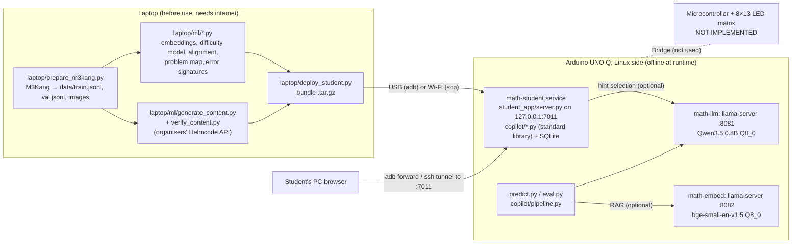

# Kangaroo Studio: an offline maths tutor on the Arduino UNO Q

Our entry to the Datathon FME 2026, Qualcomm challenge "Math on the Edge".

## What it does

Kangaroo Studio is a maths tutor that runs entirely on an Arduino UNO Q 4 GB, with no internet. A student opens a Kangaroo competition problem in English or Catalan, answers three short thinking questions (Understand, Plan, Check) before the answer choices appear, and gets feedback that names a likely slip without giving the answer away. The tutor picks the next problem from the student's own record, kept in SQLite on the board, and shows a path of gradually harder problems on a map of the training problems.

> **[PHOTO/VIDEO: the board connected over USB with the tutor open in the browser. To be added on 2026-11-15 by the team.]**

The repository also keeps `predict.py`, the official entry point that answers one letter A–E per problem. We did not improve it: see [Results](#results).

## Architecture



**On the board's Linux side.** Three systemd services:

- `math-llm`: `llama-server` on `127.0.0.1:8081` with Qwen3.5 0.8B Q8_0. It answers `predict.py`, and in the tutor it only chooses one of the stored, verified hints (grammar-constrained index, 25 s timeout, the stored hint is shown at once). It never writes text a student reads ([D-013](docs/DECISIONS.md)).
- `math-embed`: `llama-server` on `127.0.0.1:8082` with bge-small-en-v1.5 Q8_0, for RAG in `predict.py` and for preparation jobs.
- `math-student`: `student_app/server.py` on `127.0.0.1:7011`, Python standard library only. It grades with the dataset's answer key, keeps the student record in `/var/lib/math-student/progress.db`, and uses these pure-Python modules:

| Module | What it does |
| --- | --- |
| `copilot/knowledge.py`, `knowledge/` | Ten authored skills with prerequisites, 30 original diagnostics, thinking steps, hints |
| `copilot/student_model.py` | Provisional Bayesian Knowledge Tracing (unfitted defaults) plus an Elo rating |
| `copilot/scheduler.py` | Next problem: diagnostics, review dates, and about 70% predicted success |
| `copilot/difficulty.py` | Reads the laptop-trained difficulty model |
| `copilot/learning_map.py` | Problem map and stepping-stone paths (Dijkstra) |
| `copilot/misconceptions.py` | Wrong-answer feedback from error signatures |
| `copilot/content_checks.py` | Re-checks every generated text on start (no answer leak, language, length) |
| `copilot/tutor.py` | Optional background hint selection with the local model |
| `copilot/alignment.py` | Optional Catalan→English rotation for RAG queries (`ALIGN_CATALAN`, off by default) |

The student's PC only renders the page. It reaches the board over USB (`adb forward`) or over Wi-Fi (SSH tunnel). An optional Windows launcher opens the page when the board is plugged in ([board/STUDENT_DEPLOYMENT.md](board/STUDENT_DEPLOYMENT.md)).

**On the laptop, before use.** `laptop/prepare_m3kang.py` (organisers' script) downloads M3Kang and reads the options with OCR. The scripts in `laptop/ml/` train small models and export them as JSON under the git-ignored `data/ml/`: embeddings, a difficulty model, a Catalan→English rotation, the problem map and error signatures. `laptop/ml/generate_content.py` writes thinking steps, hint ladders, solutions, explanations and skill tags with a large model through the organisers' Helmcode API, and `laptop/ml/verify_content.py` rejects any item that leaks the answer, is in the wrong language or is too long. The board checks every item again.

**On the microcontroller.** Nothing. The LED matrix and the Bridge are **not implemented**. The tutor works without them.

**How we use M3Kang.** The tutor serves the training split only, never the validation split. The paper order of each problem gives a free difficulty label (Kangaroo papers go from 3-point to 5-point problems). The English/Catalan pairs train the language alignment. Numeric distractors give the error signatures. M3Kang data and everything derived from it (JSONL, images, `data/ml/`, generated content, `*.db`) stay in git-ignored folders on the laptop and the board. None of it is in this repository.

More detail: [docs/02-architecture.md](docs/02-architecture.md), [knowledge/README.md](knowledge/README.md), [student_app/README.md](student_app/README.md).

## How to replicate it

Start from a board set up with **steps 0 to 12** of the organisers' guide, [docs/DATATHON-GUIDE.md](docs/DATATHON-GUIDE.md). At that point:

- `systemctl status math-llm math-embed` shows both services `active (running)` on the board.
- On the laptop you ran step 9 with images: `python3 laptop/prepare_m3kang.py --languages eng,cat --save-images`. It ends with `train eng: 1466` and `val eng: 281`.

Commands marked **laptop** run on your computer at the repository root. Commands marked **board** run over `ssh arduino@<board-ip>`.

### 1. Get this repository (laptop and board)

```bash
git clone https://github.com/berta-r/datathon_xusigrupoo.git
cd datathon_xusigrupoo
```

Copy the prepared data from the guide's checkout into `data/` of this one (`data/train.jsonl`, `data/val.jsonl`, `data/images/`). You should see `data/train.jsonl` with one JSON problem per line.

### 2. Check the official entry point (board)

```bash
python3 predict.py --input data/sample_problems.jsonl --output results/check.csv && cat results/check.csv
```

You should see the header `id,language,answer,seconds,status` and five rows, each with one letter A–E and status `ok`. All `D` with status `error` means `math-llm` is down.

### 3. Try the tutor without M3Kang (laptop)

```bash
python3 student_app/server.py --input data/sample_problems.jsonl
```

Open <http://127.0.0.1:7011>, type a nickname and start. You should see the five sample problems and the 30 diagnostics. Stop it with Ctrl+C. Every ML file below is optional: without it the app falls back to its earlier rules.

### 4. Build the ML artifacts (laptop, optional)

Create a separate environment for the laptop-only libraries. They are not pinned in a requirements file yet.

```bash
python3 -m venv .venv-ml
.venv-ml/bin/pip install numpy scipy scikit-learn networkx umap-learn sentence-transformers
```

Run the scripts in this order. Each writes under `data/ml/` (ignored) and some write metrics under `results/`.

| # | Command | What you should see |
| --- | --- | --- |
| 1 | `.venv-ml/bin/python laptop/ml/embed_problems.py --local` | `N vectors (384-d) from …` and `data/ml/embeddings.json`. Use `--port 8082` instead, with the board's port forwarded (`ssh -N -L 127.0.0.1:8082:127.0.0.1:8082 arduino@<board-ip>`), to get the board's exact Q8 vectors |
| 2 | `.venv-ml/bin/python laptop/ml/features.py` | A table of rows per level with paper positions and points, then `wrote data/ml/features.jsonl` |
| 3 | `.venv-ml/bin/python laptop/ml/difficulty.py train` | Hold-out and cross-validation metrics; `data/ml/difficulty_model.json`, `data/ml/difficulty.json`, `results/difficulty-metrics.json` |
| 4 | `.venv-ml/bin/python laptop/ml/align.py` | `recall@1 … -> …` for train and held-out pairs; `data/ml/procrustes.json` |
| 5 | `.venv-ml/bin/python laptop/ml/build_map.py --input data/train.jsonl` | `nodes 1466 …`, cluster sizes and modularity; `data/ml/problem_map.json` (under 400 KB) |
| 6 | `python3 laptop/ml/signatures.py` | Coverage and an operation histogram; `data/ml/signatures.json`, `results/signatures-report.json` |
| 7 | `.venv-ml/bin/python laptop/ml/generate_content.py --api-base https://api.helmcode.com/v1 --kind all --resume` | Accepted and rejected counts per kind; files under `data/ml/` and `data/teaching_annotations.generated.json`; rejects in `results/content-rejects.json` |

Step 5 uses `--input data/train.jsonl` because the app never loads validation problems. Step 7 needs an API key in the `HELMCODE_API_KEY` environment variable and sends problem text to that API. Without a key, `--port 8081` uses the board's model through a forwarded port (slower, lower quality), or `--gguf <file>` runs a local GGUF with `llama-cpp-python`.

Check the laptop scripts and the app:

```bash
python3 -m unittest discover -s student_app
```

You should see `Ran 105 tests` and `OK (skipped=1)`.

### 5. Build and deploy the bundle (laptop → board)

```bash
python3 laptop/deploy_student.py --with-data
```

It writes `results/math-tutor-bundle.tar.gz` and prints its metadata (file count, SHA-256, training rows, missing images). The bundle holds the app, `copilot/`, `knowledge/`, the training data, images and `data/ml/*.json` (not `embeddings.json`). It refuses credentials, model weights, validation data and progress databases.

Over USB (find the serial with `python3 laptop/usb_launcher.py devices`):

```bash
python3 laptop/deploy_student.py --serial <BOARD_SERIAL> --with-data --install --local-tutor
```

Over Wi-Fi:

```bash
R=/home/arduino/math-tutor-releases/$(date -u +%Y%m%d-%H%M%S)
ssh arduino@<board-ip> "mkdir -p $R"
scp results/math-tutor-bundle.tar.gz arduino@<board-ip>:$R/bundle.tar.gz
ssh arduino@<board-ip> "cd $R && sha256sum bundle.tar.gz && tar -xzf bundle.tar.gz"
ssh -t arduino@<board-ip> "cd $R && python3 board/install_student_service.py --local-tutor"
```

The SHA-256 on the board must match the one printed on the laptop. Type the sudo password yourself when asked. The installer creates the `math-student` service: it starts at boot, restarts on failure and keeps progress in `/var/lib/math-student/progress.db`. Older release folders stay as a rollback.

### 6. Check the services (board)

```bash
systemctl status math-llm math-embed math-student --no-pager
curl -s http://127.0.0.1:7011/api/health; echo
free -m
```

You should see three services `active (running)` and JSON with `"app": "kangaroo-student"` and `"status": "ready"`. `free -m` should leave well over 2 GB available (we measured a minimum of 2697 MiB with both models and the tutor, see Results).

### 7. Open the tutor (PC)

Over USB:

```bash
adb forward tcp:7011 tcp:7011
```

Over Wi-Fi:

```bash
ssh -o ExitOnForwardFailure=yes -N -L 127.0.0.1:7012:127.0.0.1:7011 arduino@<board-ip>
```

Open <http://127.0.0.1:7011> (USB) or <http://127.0.0.1:7012> (Wi-Fi). You should see the blue start page. Type a nickname, open a problem, answer the three thinking steps, then choose a letter. The problem map is at `/map?student=<nickname>`. To open the page automatically when the board is plugged in, follow the Windows setup in [board/STUDENT_DEPLOYMENT.md](board/STUDENT_DEPLOYMENT.md).

### 8. Run the tests on the board (board)

```bash
python3 -S -m unittest discover -s student_app 2>&1 | tail -3
```

`-S` proves the code needs nothing beyond the standard library.

## Results

**Read this first.** All numbers come from [docs/EXPERIMENTS.md](docs/EXPERIMENTS.md) and [docs/STATUS.md](docs/STATUS.md), where each one has its commit and conditions. Our own reasoning results are on **30 problems** (50 or fewer, so treat them as indicative only). There is **no RAG or ablation row** from our board, and there are **no real-student metrics**. The local `results/ablations.csv` holds five laptop runs from the separate `exp/reason-strategies` branch (commit `6dcbc88`), which are not recorded in this branch's EXPERIMENTS, so we do not quote them here.

### Reason: `predict.py`

| Run | Problems | Accuracy | Mean / worst latency | Over 60 s | Conditions |
| --- | --- | --- | --- | --- | --- |
| Organisers' baseline | 40 English, text-only, OCR options | 22.5% (9/40) | 8.7 / 12.7 s | 0 | Organisers' measurement, template code |
| Always `D` | same 30 as below | 43.3% (13/30) | 0 s | 0 | The answer key of our small validation sample |
| `unoq-wifi-baseline` | 30 English validation | 36.7% (11/30) | 10.4 / 25.6 s | 0 | UNO Q, RAG k=0, solver unchanged from the template, development deployment (commit `c081129` + uncommitted teaching work) |
| `usb-setup-v1` | same 30 | 36.7% (11/30) | 8.3 / 12.3 s | 0 | Same solver; deployment continuity check, not an improvement |

Our board baseline trails always-`D` on this small, D-heavy sample. It does not show that the model reasons reliably, and it says nothing about the hidden test. We kept the organisers' solver unchanged on this branch.

### Teach: the tutor's models

| What | Result | Conditions |
| --- | --- | --- |
| Difficulty model (points 3/4/5 from paper position) | Gradient boosting 0.516 hold-out accuracy vs 0.395 majority class; MAE 0.644 points; Spearman 0.435 with paper position (0.475 within paper). Decision tree: 0.465. CV accuracy 0.474 ± 0.015 | 1747 problems; hold-out years 2023–2024 (215 rows); CV grouped by year; laptop fp32 bge-small embeddings |
| Catalan→English alignment (orthogonal Procrustes) | recall@1 0.501 → 0.725; recall@5 0.696 → 0.894 | 1398 training pairs, 349 held out (seed 42), search over all 1747 English vectors. Training recall@1 is 0.97, so the fit overfits; quote held-out only |
| Problem map | 1466 problems, 5858 edges, 14 clusters, modularity 0.688 | Training ids only; kNN k=5 cosine, Louvain and UMAP with seed 42 (`results/map-metrics.json`). A first build on all 1747 ids had 15 clusters, modularity 0.699 |
| Map across languages | A Catalan problem's nearest English neighbour falls in its English twin's cluster 0.722 (unaligned) → 0.888 (aligned) | 349 held-out ids, 1747-node build; English-to-English baseline 0.907 |
| Error signatures | 981 of 3220 numeric distractors (30.5%) match one naive operation on the problem's numbers; 402 (12.5%) excluding copied numbers and off-by-one | 805 problems whose five options are all numbers; coincidence limit 0.6 |
| Signature spot check | 11/30 explanations judged plausible, 19/30 coincidences | 30 random explained distractors (seed 2026), judged by an AI agent, not a human |
| Live SLM probe: Socratic question | 1/5 useful, 4/5 restated the problem, 1/5 leaked the answer; about 19 s estimated on the board | Board GGUF on the laptop, temperature 0, seed 42, five sample problems; board time estimated from token counts at 11 / 5.5 tok/s |
| Same with a teacher fact and two examples | 1/5 useful, 1/5 leaked; about 38 s estimated | Same conditions |
| Live SLM probe: strategy label for the student's note | 7/12 correct; about 9 s estimated | Grammar-constrained, 8 labels |
| Live hint selection on the board | 10.1–23.0 s for 4 requests; stored hint shown in 16–21 ms | UNO Q over Wi-Fi, 2026-11-14 release (before the ML bundle) |
| Memory on the board | Minimum MemAvailable 2697 MiB, swap 0; LLM RSS 1058.7 MiB, embeddings 76.4 MiB; tutor service peak 18.1 MiB | 206 samples every 2 s during contract check, evaluation and repeat, 2026-11-14 release |
| Selector simulation (synthetic learners) | Weak-skill targeting: adaptive 36.8%, random 22.0%, correct-harder 23.5% | 30 synthetic learners × 20 recommendations, seed 42; a proxy, not a learning gain; predates the current path-first policy |
| Tests | 105 student-app tests pass, 1 skipped | Laptop, branch `exp/ml-tutor`, 2026-11-15 |

The difficulty, alignment and map numbers use laptop fp32 vectors of the same bge-small model; the board serves the Q8 GGUF. Board timing and memory of the new ML bundle are not measured yet (T-110).

## Error analysis

**What exists.** For the 30-problem board baseline (`unoq-wifi-baseline`), all English:

| Slice | Correct / problems |
| --- | --- |
| Options read by OCR as text | 7/17 |
| Options only in the image | 4/13 |
| Level 0 | 7/20 |
| Level 1 | 4/10 |

The model's letters were A/B/C/D/E = 7/9/1/12/1, while the true answers were 2/6/7/13/2. It almost never chose C, which was right 7 times. The text-only server cannot see the diagrams, but these counts do not prove that OCR or missing diagrams caused individual errors.

On the teaching side, the signature spot check (11/30 plausible) and the SLM probes (1/5 useful Socratic questions) are our error analysis so far. They are why signature messages say "could come from" and why the small model never writes student-facing text.

**What is pending.** The analysis by topic, language and level on a larger set, with counts and ten wrong answers explained by hand (T-071), is not done. M3Kang has no topic field, there is no Catalan board run, and 30 problems are too few for per-slice conclusions.

## What didn't work, and what's next

What didn't work:

- **Reasoning with the 0.8B model.** On our 30 problems it scored below always-`D`. We left `predict.py` as the organisers' baseline.
- **Live content from the small model.** As a live Socratic tutor it gave 1 useful question in 5, leaked the answer once, and would take about 19–38 s per turn. We moved all student-facing text to offline generation with a large model plus Python checks ([D-013](docs/DECISIONS.md)).
- **Grading free text with the small model.** 7/12 correct strategy labels is too unreliable to show a child. Free-text reflection was replaced by multiple-choice thinking steps with authored feedback ([D-012](docs/DECISIONS.md)).
- **Skill tags by label propagation** (option 4 in [docs/ML-OPTIONS.md](docs/ML-OPTIONS.md)) was not built. Skill tags now come from the offline generator, with the 51 earlier tags kept as human-precedence entries.
- **Arithmetic error signatures** cover 30.5% of numeric distractors, but only 11/30 of a spot check looked like a real slip. Copied numbers are the reliable part.

What's next:

- **Educator review** of the generated content, the 51 provisional tags and the signature messages; a human repeat of the 30-item signature check.
- **Board measurements** of the ML bundle: deployment, memory, and `/api/recommendation` and `/map` latency (T-110).
- **Board embeddings.** Regenerate the ML artifacts with the board's Q8 vectors (`embed_problems.py --port 8082`) and compare with the fp32 numbers above. Measure `ALIGN_CATALAN=1` with `eval.py --languages cat`.
- **Error analysis** by topic, language and level (T-071).
- **Real students.** The process metrics are defined but not measured (T-093). BKT parameters are unfitted defaults. We claim no learning gain.
- **The LED matrix** through App Lab and the Bridge.

## The team

GitHub handles from the commit history:

- `berta-rov` (repository owner on GitHub: `berta-r`)
- `joancardonall` (also committed as "Joan Cardona")
- `liamotal01`

> **[TEAM: add full names and roles on 2026-11-15.]**

Commits by `mpous` / Marc Pous are the organisers' template.

## Licenses and credits

- **Our code:** MIT, see [LICENSE](LICENSE).
- **M3Kang:** Qualcomm, research use only. See the [dataset card](https://huggingface.co/datasets/qualcomm/M3Kang). Cite: Torres-Camps et al., 2026, *M3Kang*, [arXiv:2601.16218](https://arxiv.org/abs/2601.16218). No M3Kang data is in this repository.
- **Organisers' template:** the board scripts, `predict.py`, `eval.py`, `build_index.py`, `copilot/` base modules, `explorer/`, `laptop/prepare_m3kang.py`, `.skills/` and the guide in [docs/DATATHON-GUIDE.md](docs/DATATHON-GUIDE.md) come from [mpous/datathon-UPC-maths-qualcomm-arduino-unoq](https://github.com/mpous/datathon-UPC-maths-qualcomm-arduino-unoq).
- **llama.cpp:** [ggml-org/llama.cpp](https://github.com/ggml-org/llama.cpp), MIT, pinned to commit `2cbe0ec429b849a88664e0f62388fc92a5abd699` in `config.env`.
- **Qwen3.5 0.8B:** by the Qwen team, GGUF by bartowski. License on the [model card](https://huggingface.co/bartowski/Qwen_Qwen3.5-0.8B-GGUF).
- **bge-small-en-v1.5:** by BAAI, GGUF by CompendiumLabs. License on the [model card](https://huggingface.co/CompendiumLabs/bge-small-en-v1.5-gguf).
- **RapidOCR:** [RapidAI/RapidOCR](https://github.com/RapidAI/RapidOCR), Apache 2.0 (laptop OCR).
- **Offline content generation:** the organisers' Helmcode API (OpenAI-compatible, models `deepseek-v4-flash` with `glm5.3-flash` as fallback). Generated content is model-written, verified automatically, and not yet reviewed by an educator.
- **Laptop ML libraries:** scikit-learn, SciPy, NumPy, NetworkX, umap-learn, sentence-transformers.

## Repository map

```
README.md                  this file
LICENSE                    MIT, our code
config.env                 pinned models, llama.cpp commit, ports, limits
predict.py, eval.py        official entry point and evaluation (organisers)
build_index.py             RAG index of the training set
copilot/                   standard-library modules: solver, RAG, student model, map, checks
student_app/               offline tutor: server.py, assets/, tests
knowledge/                 skills, diagnostics, thinking steps, relations
laptop/                    data preparation, deployment, Windows launcher
laptop/ml/                 ML artifacts and offline content generation
board/                     board setup scripts, service installer, systemd templates
explorer/                  organisers' problem explorer
docs/                      our documentation and the organisers' guide
data/                      sample_problems.jsonl only; M3Kang data stays local
```

## Documentation

- [docs/DATATHON-GUIDE.md](docs/DATATHON-GUIDE.md): the organisers' guide, steps 0–15 (board setup)
- [docs/01-challenge.md](docs/01-challenge.md): the challenge and the rules
- [docs/02-architecture.md](docs/02-architecture.md): how the code fits together
- [docs/STATUS.md](docs/STATUS.md): what works today
- [docs/EXPERIMENTS.md](docs/EXPERIMENTS.md): every measurement with its conditions
- [docs/DECISIONS.md](docs/DECISIONS.md): why things are the way they are
- [docs/ML.md](docs/ML.md): how the tutor chooses the next problem (difficulty, rating, the 70% rule, map and paths), with the formulas and numbers
- [docs/ML-OPTIONS.md](docs/ML-OPTIONS.md): the ML options we considered and built
- [docs/PROJECT-HUB.md](docs/PROJECT-HUB.md): the Arduino Project Hub write-up
- [student_app/README.md](student_app/README.md), [knowledge/README.md](knowledge/README.md), [board/STUDENT_DEPLOYMENT.md](board/STUDENT_DEPLOYMENT.md), [laptop/ml/README.md](laptop/ml/README.md)
- [AGENTS.md](AGENTS.md): entry point for AI coding agents
