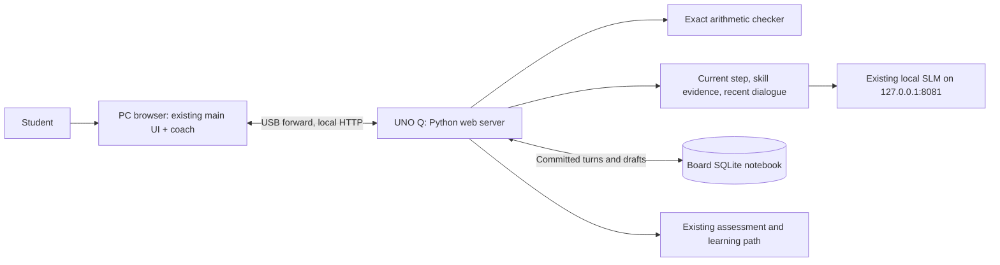

# Offline learning coach: implementation and handover

This feature combines the current `main` interface with a persistent coach on
`exp/slm-learning-coach`. Main was merged through `0b42034`; earlier dialogue work
remains preserved at `694d2b6`. The merge keeps main's thinking steps, problem
display, skill tree, learned difficulty, map paths and independent-evidence rules.
For visual changes, start with [DESIGN.md](DESIGN.md) and
[COACH-DESIGN.md](COACH-DESIGN.md).

## What the student does

Open a notebook and use **Help me think it through** while solving a problem. Enter a
calculation, a proposed result, or a question about the idea. The reply is saved
on the same machine that runs the server; in the deployed product that is the
Arduino, not the browser. **Number practice** is a separate conversation for
calculations outside an exercise.

| Input | Behaviour |
| --- | --- |
| `What is 18 - 6?` in Number practice | Python returns `12` and checks it by adding back. |
| The same input in an unfinished exercise | Ask for `8 - 6` after splitting `18` into `10 + 8`, then ask for `10 + 2`. |
| `I got 13 for 18 - 6` | Detect the mismatch and ask the student to check a smaller step. |
| `Why does subtraction work?` | Ask the local SLM for a short explanation using the available learning context. |

The coach conservatively guides **all** arithmetic inside an unfinished exercise;
it does not pretend to know whether every arbitrary calculation solves the
exercise. Checking a numerical step never proves that the whole problem is solved.
Conversation is help, not evidence of mastery. Exercise help marks that attempt
as assisted; independent answers still drive main's BKT/Elo and recommendations.

## Where everything runs



The Arduino's Linux processor runs Python, SQLite and the SLM. Its microcontroller
does not run the web app. The PC only displays the browser and runs the existing
small USB launcher. The deployed runtime needs no App Lab, cloud API, Python
installation on the student's PC, CDN, npm service or third-party Python package
on the board. The board must already have the model and system services installed.

Arithmetic supports decimal numbers, fractions, parentheses, unary signs and
`+ - * /`, including common English/Catalan operator words. A bounded AST walker
uses exact rational arithmetic; it never executes student input. Algebra,
percentages, powers, arbitrary Python and reading new image content are outside
this tool. Images continue to display normally; a text-only SLM cannot inspect
their pixels. Conceptual replies are model-generated, not mathematically certified.

The coach uses the existing local model and a bounded asynchronous worker, with
temperature zero and seed 42. It does not load a second model. Slow, unavailable
or rejected model replies get an explicitly labelled prepared fallback. Numeric
answers verified by Python do not go through the generic generated-number filter.

## Data and offline release

`data/train.jsonl`, its referenced images, teaching annotations and compact
`data/ml/*.json` artifacts are included by `--with-data`. Raw embedding arrays,
validation data, credentials, model weights and student databases are excluded.
`release-manifest.json` lists included files, hashes and missing optional ML
artifacts. The archive is for the team's permitted research use; do not commit or
publish the M3Kang data.

This checkout currently has **170 training rows and all 170 original images**.
It does **not** have the newer learned map, difficulty table or generated-content
files. Their loaders and UI remain supported, with existing fallback behaviour.
For the full team demo, copy the matching prepared training data and ML artifacts
from the team's data preparation machine, then rebuild. Do not mix a map generated
for different IDs/languages with an unrelated train split. See [ML.md](ML.md).

## Developer run on the laptop

From the repository root:

```powershell
python student_app/server.py --port 7014 --db results/coach-preview.db
```

Open `http://127.0.0.1:7014`. Arithmetic, stored guidance and saving work without a
model. Add `--local-tutor` only when the configured local model endpoint exists.
Running the app on a laptop saves data on that laptop; it does not test board
persistence or board inference. Use a separate preview database to avoid mixing
test sessions into a student's notebook.

## Build and install on the Arduino

On the developer **PC**, build a local archive:

```powershell
python laptop/deploy_student.py --with-data --output results/slm-coach-bundle.tar.gz
```

Connect the already configured board, identify its serial, and stage/install:

```powershell
python laptop/usb_launcher.py devices
python laptop/deploy_student.py --with-data --serial BOARD_SERIAL --install --local-tutor --safe-shutdown
```

The second command stages a new release, verifies its SHA-256, and runs the board
installer. Enter the board's sudo password in that terminal when asked. It backs
up the existing SQLite database and service unit before changing the service.
The database remains `/var/lib/math-student/progress.db`; never replace it with a
developer database. Existing history and older conversation tables are retained.
The service starts automatically at board boot and uses the existing model service.

Activation refuses to remove currently installed training IDs or ML artifacts.
If it reports missing content, obtain the matching files and rebuild before
installing. Only an intentional dataset reduction should use `--allow-data-change`;
the default installation command does not bypass that protection. File presence
does not prove that artifacts match the new split: that still needs team review.

For staging without activation, omit `--install`. The command prints the exact
board-side installation command. The app service uses the existing 256 MB memory
limit, separate from the existing model process; measure full-board RAM and model
latency during hardware acceptance before claiming a new performance result.

The previous **START.EXE** and read-only **MATHTUTOR** setup drive remain compatible;
they discover the same `kangaroo-student` service on board port 7011. There is no
need to rebuild or reinstall the Windows launcher for this UI update. On this
configured PC it forwards to port 7013. A fresh Windows computer still requires
the student to run START.EXE once; USB devices cannot silently install software
on arbitrary computers. Thereafter the installed watcher opens the browser on
reconnection. See [the deployment guide](../board/STUDENT_DEPLOYMENT.md).

## Acceptance before changing the demo board

1. Run the four inputs above; confirm guided follow-ups survive a page reload.
2. Ask two different conceptual questions with the actual model; inspect that the
   source is the local tutor and record reply quality and latency. A mocked model
   test proves integration, not teaching quality.
3. Ask for help, finish the exercise and confirm it counts as assisted practice.
   Complete a different exercise independently and confirm learning estimates
   still update through the existing assessment flow.
4. Save a draft, restart the app and reopen the notebook. Verify the conversation,
   draft and learning profile survived. Then repeat after safe power-off and USB
   reconnection, with Wi-Fi disabled.
5. Check desktop/mobile layout, image enlargement/closing and both languages.
6. Confirm the release manifest includes the team's matching ML artifacts if the
   demo promises a learned problem map. Missing files must remain explicit.

Use **Finish & safely disconnect** before removing power. Saving each message
protects against browser closure; it cannot guarantee flash integrity after
arbitrary removal of power during a write. Roll back by reinstalling the prior
release's service without replacing the persistent database. The installer records
its backup directory in `last-install-backup.txt` inside the new release.
